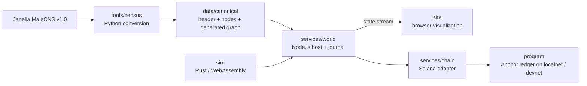

# Connectome Life Sim

[](https://github.com/omarpatel/connectome-life-sim/actions/workflows/ci.yml)
[](LICENSE)


A connectome-based artificial-life experiment: a deterministic Rust simulation, a browser visualization, and a Solana development ledger for creature identity and reproducible state commitments.

## Overview

Instar uses the Janelia FlyEM **MaleCNS v1.0** wiring dataset from one adult male *Drosophila melanogaster*. The converter selects 166,700 annotated neuron bodies and 6,242,118 directed connections with at least five synapses. Synapse counts initialize the simulation's connection weights; weaker connections are excluded.

**This is not a biologically faithful fly simulation.** The engine supplies simplified integer threshold dynamics, sensory inputs, motor mappings, body mechanics, metabolism and reproduction. The connectivity data does not establish those dynamics, synaptic polarity or realistic behavior. A fly moving or feeding in this world is behavior of this model, not evidence that a real nervous system has been reproduced. Mutated descendants are artificial-life experiments rather than additional biological reconstructions.

This repository is a source port for **local validators and Solana devnet only**. The original deployment, its accounts, transaction history and launch material are excluded. No active deployment, financial performance, production readiness or external audit is claimed.

## Features

- **Deterministic engine:** integer-only Rust compiled to native code or WebAssembly; seeded simulation, genome inheritance and state digests.
- **Real connectivity input:** a documented, thresholded conversion of published MaleCNS data, with input hashes and a canonical Merkle root.
- **Interactive visualization:** streamed world state and browser-side inspection of creatures and neural roles.
- **Development ledger:** an Anchor program recording ancestry, asset ownership and epoch commitments, separate from the off-chain simulation.
- **Replay tooling:** input journals, snapshots and epoch replay for comparing the engine's recorded state with ledger commitments. This establishes reproducibility, not biological validity.

## Architecture



The world process runs the neural model off-chain. The program stores identities and commitments; it does not execute neurons. A committed state digest is a comparison target for replay, not a proof that a particular biological model is correct.

## Tech stack

- **Engine:** Rust 2021, integer fixed-point arithmetic, WebAssembly.
- **Host:** Node.js 22+, TypeScript, `tsx`, HTTP and streamed state.
- **Frontend:** browser JavaScript, three.js, WebAssembly verification tools.
- **Ledger:** Anchor 0.31, Solana, Metaplex Core.
- **Data tooling:** Python 3; PyArrow for reading the source Feather tables.

## Getting started

### 1. Install dependencies and regenerate the graph

Run commands from the repository root. Install Node.js >= 22.18, Python 3, and Rust with `rustup` first.

```bash
npm install
python -m pip install pyarrow
python -m tools.census fetch malecns
python -m tools.census convert malecns
rustup target add wasm32-unknown-unknown
cargo build --manifest-path sim/Cargo.toml --target wasm32-unknown-unknown --release
node -e "require('node:fs').copyFileSync('sim/target/wasm32-unknown-unknown/release/instar_sim.wasm', 'site/instar_sim.wasm')"
```

The source download is approximately 1.07 GB and comes from Janelia's public data bucket. `fetch` stores the two source tables under `data/raw/malecns/`; `convert` writes the canonical header, node annotations and binary graph under `data/canonical/`. Conversion records input hashes and verifies the resulting canonical representation. Allow additional memory for reading the connectivity table.

The generated `male-cns-v1.0.census.cbg` is about 82 MB and is intentionally **not committed**: data files above 50 MB are excluded from this port. The retained header and node annotations are not a substitute for that graph. Regenerate it before starting the host. See [the schema specification](docs/SCHEMA.md) for the exact source names, ordering, threshold and reference hashes.

### 2. Configure the development ledger

The host is chain-backed; `npm start` is **not** an offline demo or a deployment command. Before starting it, provide a local validator or devnet with the matching program, Metaplex Core and an initialized World/collection. You need the Solana/Agave and Anchor toolchains for this separate integration setup. Install program-specific JavaScript dependencies with `npm install --prefix program`.

The program public identifier is recorded in the source configuration and generated IDL; its presence does not mean a program is deployed. The generated IDL, Rust declaration, Anchor configuration and browser pin must agree with the program you actually run. A public identifier cannot sign deployment or initialization transactions.

Configure these variables in your shell or local process environment:

| Variable | Purpose |
|---|---|
| `INSTAR_CLUSTER` | `localnet` (default) or `devnet` only |
| `INSTAR_RPC` | RPC endpoint for that development cluster |
| `PROGRAM_ID` | Matching development program public identifier; must agree with the generated IDL and source configuration |
| `INSTAR_OPERATOR_KEYPAIR` | Path to your locally managed operator keypair; the operator must match the initialized World |

Keep private keys, account stores, raw downloads and runtime state outside version control. Do not reuse identities or accounts from an earlier installation. See [the program specification](docs/PROGRAM.md) for account relationships, initialization requirements, instruction semantics and recovery state transitions.

For a disposable **local validator**, install Bash, Solana/Agave and Anchor on `PATH`, then run:

```bash
bash scripts/dump-mpl-core.sh
npm run program:build
npm run localnet
```

`localnet` runs in the foreground and resets its disposable ledger on startup; do not point it at a ledger you need to keep. Leave it running. It preloads the built program and Core, and creates/funds a local development operator if needed. In a second terminal with the same environment, initialize the World:

```bash
npm run world:init
```

The initializer creates a distinct local recovery identity when one is not provided. For devnet, provision the matching program independently, set `INSTAR_RECOVERY` to a recovery public key distinct from the operator, and provide a publicly reachable `PUBLIC_URL` or `INSTAR_COLLECTION_URI`; localhost metadata is rejected there. No production deployment procedure is included.

### 3. Start the host

With the canonical graph, copied WASM artifact and initialized development ledger available:

```bash
npm start
```

Open `http://localhost:8787`. Starting the host can submit development-cluster transactions through its configured operator; use only disposable localnet/devnet assets. Missing signing material or an absent/mismatched World is a setup error, not a signal to connect to an old deployment.

## Project structure

| Path | Contents |
|---|---|
| `sim/` | Deterministic simulation and WebAssembly ABI |
| `services/world/` | Engine host, journal, snapshots, API and streamed state |
| `services/chain/` | Development-cluster adapter and generated IDL |
| `site/` | Browser visualization and replay interface |
| `program/` | Anchor accounts, instructions and integration tests |
| `tools/census/` | Source fetcher, converter and canonical-format verifier |
| `data/canonical/` | Dataset provenance header and node annotations; binary graph generated locally |
| `scripts/` | Build, probe, replay and development integration tools |
| `docs/` | Canonical data format, program design and licensing |

## Data provenance and limitations

The [MaleCNS project](https://male-cns.janelia.org/) explicitly licenses the dataset under [CC BY 4.0](https://creativecommons.org/licenses/by/4.0/). Credit: Berg, Beckett, Costa, Schlegel and collaborators, *Sexual dimorphism in the complete connectome of the Drosophila male central nervous system*, [bioRxiv](https://doi.org/10.1101/2025.10.09.680999), published in *Cell* (2026); Janelia FlyEM and collaborators.

This repository modifies the data's representation and filters connectivity by synapse count. It retains source annotations for sensory and motor role mapping, but does not infer missing physiological measurements. Source authors do not endorse this simulation. See [LICENSES](docs/LICENSES.md) for attribution, modification notices and third-party license separation.

## License and upstream credit

Code: [MIT](LICENSE), copyright Omar Patel. This port preserves the engineering work of the original **Instar upstream contributors**; that credit is distinct from dataset authorship. The MaleCNS dataset remains CC BY 4.0, and bundled fonts and libraries retain their own licenses.
